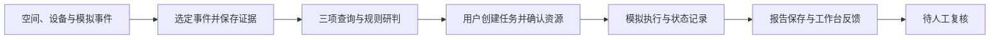

# 天亨 SKYDOME Agent｜产品介绍与讲解稿

适用：项目汇报、合作交流、产品演示。更新日期：2026-11-16。依据为当前源码、使用手册及 DAY 05 已保存验收记录；本次没有重新执行验收测试。

## 开篇：约一分钟介绍

天亨 SKYDOME Agent 面向高校校园和园区安全管理，把空间地图、设备信息、异常事件、风险核查和巡检任务组织到同一个工作流程中。我们的切入点，是让值班人员在看到一个异常后，能够知道它发生在哪里、关联哪些设备、依据是什么、下一步由谁或什么资源执行，以及结果如何回看。

以实训基地温度异常为例，用户从地图选择设备，系统查询同一事件的监测记录、设备状态和历史事件，生成带证据与信息缺口的规则研判报告。用户据此创建巡检任务、选择无人机模拟资源，观察路线和执行进度，完成后查看报告，并在工作台回看同一任务的结果。

目前我们已完成可运行的本地演示版本，验证了从事件证据到模拟执行反馈的数据和交互链路。校园空间采用学校规划图片，监测与巡检使用模拟数据，研判采用规则流程。下一阶段重点是接入真实数据和受控的大模型辅助分析，通过单场景试点验证业务效果。

## 1. 产品定位与解决的痛点

### 一句话定义

**天亨 SKYDOME Agent 是面向高校校园与园区安全管理的空间可视化与事件协同处置平台，以证据驱动的辅助研判连接异常发现、巡检任务和结果反馈。**

产品方向是数字孪生与 Agent 融合；当前版本应称为“可交互的本地演示原型”或“数字孪生应用原型”，不称为已部署的真实三维自主运维系统。

### 目标用户与职责

| 角色 | 主要问题 | 产品支撑 |
|---|---|---|
| 安保值班人员、运维人员 | 收到异常后如何快速定位并查清相关信息 | 地图定位、关联设备、事件证据、核查报告 |
| 巡检人员、设备运维人员 | 要检查什么、目标在哪、任务依据是什么 | 明确任务对象、资源、日志和来源 |
| 校园管理部门、园区物业负责人 | 任务有没有执行、结论有没有依据、结果可否复盘 | 任务状态、报告和历史关联 |
| 信息化部门、系统集成伙伴 | 数据怎样接入、系统怎样衔接 | 当前接口结构，后续设备与业务系统适配 |

这些是目标角色，当前产品尚未实现对应的登录账号和角色权限，不能把目标用户表当作已完成的权限矩阵。

### 需要验证的业务痛点

1. **信息分散**：空间位置、传感器、视频、事件与任务分布在不同系统或记录里，核查时需要来回查找。
2. **告警缺少上下文**：单条高温记录不能说明原因，还需看时间变化、烟雾状态、通信质量及相关历史。
3. **分析与执行脱节**：分析意见没有稳定关联到执行任务，后续很难确认按什么依据做了什么。
4. **结果难追溯**：后续读数变化后，难以还原当时依据；任务完成也不等于风险已经解除。

以上是本产品瞄准的需求假设，不是已经对该校实地调研后得出的客户结论。合作前需要访谈值班、设备和管理人员，核对现有系统已有能力、真正耗时的环节与职责边界。

### 产品价值怎样讲

当前已可展示的价值，是把空间对象、证据、报告和任务放入同一可追溯流程，减少重复查找和上下文丢失的机会。缩短核查时间、减少遗漏、降低沟通成本是预期收益；降人力、降低漏报率和事故率尚无实测依据，不能给出改善百分比。

试点可测量：从打开告警到证据齐备的时长、从核查到任务创建的时长、人工跨系统切换次数、报告证据完整率、建议人工采纳率。误报、漏报需有真实标注事件、合理样本及基线，不能拿本地测试通过率替代。

## 2. 核心能力：按工作流程讲

### 看清对象：空间与设备定位

用户先在校园规划图片地图上定位建筑、设备和事件，查看当前保存的监测数据及相关对象。支持缩放、拖动、图层开关和点击详情。归一化坐标保证窗口和地图缩放时标记仍能跟随图片。

当前是图片与 SVG 交互地图，没有 Three.js、Cesium 或真实三维模型，不具备任意旋转建筑和实时测绘能力。设备点位、楼层和巡检路线均按模拟或待核实范围展示。

### 查清依据：事件证据与规则研判

用户选择事件并发起核查后，后端实际执行三项工具：监测数据查询、关联设备查询、历史事件查询。系统冻结本次证据，输出规则风险判断、温度趋势、可能原因、建议和信息缺口。

报告来自实际查询结果与规则计算，不是每个事件同一份固定文本。但流程和工具顺序固定，尚不是大模型自主选择工具、动态推理或多 Agent 分工。自然语言输入用于提交核查目标，不能据此宣称开放域智能对话。

### 组织行动：从结果创建任务

核查成功后，用户点击创建关联任务，保留事件、设备、建筑与证据来源，再到任务中心选择资源、保存分配并确认启动。无人机、地面机器人和卫星遥感采用不同模拟资源类型。

创建任务和启动均有人为操作；不是无人值守自动派单，不等于正式工单审批流程。

### 跟踪结果：进度、记录和复盘

任务状态和日志由后端保存；地图展示模拟路线与移动位置。完成后生成任务专属报告，并反馈到来源工作台。取消、重试和刷新恢复保留原始记录，重试使用新任务编号。

完成代表模拟执行流程结束，事件仍需人工复核。产品目前打通的是“事件到执行反馈”的演示闭环，尚未完成真实现场核验、审批和风险关闭的业务闭环。

辅助能力包括预置知识检索、历史分析、模拟场景训练和运行状态查看。当前有业务过程记录，但没有账号、角色授权和完整安全审计系统。

## 3. 产品架构与配合方式

### 面向管理者的解释

系统分为三层：底层保存空间、设备、事件和任务数据；中间将选中事件的证据汇总并形成规则结论，再关联后续任务；上层以地图、工作台和任务中心让用户查看、确认和跟踪。

各页面围绕同一个事件和任务工作，因此地图发现的事件不会在工作台变成另一组数据，任务执行结果也能回到来源核查。

### 面向技术人员的解释

- 前端 Vue 3 + TypeScript + Vite；地图采用真实资料图片和 SVG 交互层。
- 后端 FastAPI 暴露查询、核查、任务、资源与报告接口。
- SQLite 保存事件、观测、证据快照、核查运行、执行任务、日志和报告。
- 核查过程通过 SSE 展示事件记录；任务状态通过轮询读取，地图按保存路线和进度更新位置。
- 稳定 ID 关联对象；数据库事务和幂等处理减少重复建单、重复占用资源。

实际技术范围中没有产品内置多 Agent 调度、生产消息队列或持续遥测系统。执行进度按保存时间在查询时推进，不是真实硬件的持续后台作业。

开发时的前端 Agent、后端 Agent、调研 Agent 是使用 Codex 协作开发的角色，不能放入产品架构作为已交付功能。未来若有多 Agent，应围绕证据核查、预案检索、计划评估等业务职责设计，并以确有价值为前提。

## 4. 用户完整流程：用一个事件讲清楚

本地启动产品后，进入全域态势，选择物流与航空实训基地和 TEMP-008；固定场景展示 68.5℃的模拟温度记录。关联事件 EVT-008 后，用户发起证据核查，系统查询同事件烟雾状态、设备状态和历史，结合温度趋势输出规则报告。

报告说明温度异常不等于火灾，还缺少现场核验和工况资料。用户根据结论创建无人机巡检任务，选择 UAV-003，保存资源并确认启动。在地图上观察路线与进度，完成后查看任务报告，再返回工作台确认反馈。

现场演示主线：**定位异常 → 核对证据 → 规则研判 → 用户确认建任务 → 选择模拟资源 → 执行 → 报告与反馈。**

此版本无账号登录，直接从本地启动进入。TASK-008 是已验收根任务，重复演示应创建重试任务并讲实际新编号。约 27 秒的过程是预设模拟时长，不能作为响应效率或真实无人机作业时间指标。

## 5. 界面与交互：为什么这样设计

全域态势承担“在哪里、涉及谁”的问题，中央保留校园空间图，侧边放事件和对象详情。设备或事件点击后延续选择上下文，进入工作台查看证据和工具过程，避免反复填写对象。

工作台承担“依据是什么、结论能否相信”的问题，所以把工具记录、采样时间、证据与不确定性展示出来。任务中心承担“下一步做什么、进行到哪”的问题，集中展示任务状态、资源、日志和报告。

深蓝与青色用于统一产品视觉，风险颜色辅助区分级别；状态同时用文字标注，不能只靠颜色理解。详情抽屉、搜索筛选和按需展开日志降低同时呈现的信息量。

可以演示的交互包括空间对象点击、设备事件关联、文本目标输入、任务筛选、资源选择、模拟路线和报告导出。不要演示成支持任意三维漫游、自然语言控制真实无人机或可视化编辑多 Agent。

## 6. 差异化：强调选择，不贬低同行

不能把“数字孪生都只能显示”和“通用 Agent 都不能操作系统”当作事实。Azure Digital Twins 已有事件路由与计算服务联动；Copilot Studio 也支持连接工具和 REST API。[Azure 官方事件路由说明](https://learn.microsoft.com/en-us/azure/digital-twins/concepts-route-events)、[Copilot Studio 官方工具说明](https://learn.microsoft.com/en-us/microsoft-copilot-studio/advanced-plugin-actions)。

更准确的三个比较维度是：

1. **相对于以展示为主的配置**：本项目把事件证据、任务执行与报告反馈放入同一次操作流程。并不声称其他孪生平台做不到联动。
2. **相对于未接入领域业务的聊天入口**：本项目先绑定建筑、设备、事件和证据，再组织核查与执行；通用 Agent 通过业务集成也能具备这些能力。
3. **相对于直接投入完整三维建设**：当前用已有学校图片验证操作流程，前端没有引入重型三维引擎；这降低了本原型对三维素材的依赖，但没有真实几何能力，也未量化总成本优势。

当前可展示的特点：**场景绑定明确、分析证据可追溯、执行结果能回到来源。** 这些是当前设计特征，不是经竞品实测确认的独占壁垒；长期竞争力需依靠现场数据、接口适配、可靠性与使用效果积累。

## 7. 交付形态与部署方式

当前可交付：Windows 本地软件项目、前后端服务、SQLite 数据、桌面启动入口、图片地图素材、演示场景、使用手册、接口文档和验收记录。浏览器访问本机地址，不是公网 SaaS；本地能运行也不等于已完成企业生产私有化部署。

候选商业形态如下，均须进一步产品化：

| 方向 | 适用条件 | 尚需补齐 |
|---|---|---|
| 软件平台私有化交付 | 客户已有设备与数据平台 | 部署包、账号权限、接口鉴权、备份恢复、监控和运维流程 |
| 平台加场景服务 | 需要重新梳理空间和设备台账 | 合法素材、测绘建模、设备映射、验收标准与服务边界 |
| 云端服务 | 客户允许数据进入约定云环境 | 多租户、隔离、权限、计费、安全评估、服务保障 |
| 软硬一体 | 确有巡检硬件业务与合作方 | 设备供应商协议、控制接口、运行与维护责任、现场验收 |

Docker 尚未打包，不能说当前已支持一键容器部署。也不能把“可以规划三维建模服务”说成现有团队已有标准建模交付能力。

## 8. 当前成熟度与验证情况

### 可讲的成熟度

**已完成本地可运行演示原型与功能联调，进入准备真实单场景验证的阶段。**尚没有材料证明校方采购、授权试点、真实设备部署或正式商业运营。使用浙江交通职业技术学院资料作为演示场景，不代表该校已经部署产品或为产品背书。

### 已保存的验证证据

DAY 05 验收记录显示：16 步主流程实际操作完成；后端 67 项、前端 7 项回归通过；19 项运行时关联和数据保留检查通过；任务、证据和报告在服务重启后保留。当前说明复核了这些记录，没有把它们称为本次重新执行的结果。

这些证明特定本地场景的程序功能与数据链路，不证明风险识别准确率、生产可用性、并发能力或人力节省。没有真实标注评估集、长期在线记录及客户对照数据，因此不提供“准确率 99%”“响应缩短 80%”等数字。

### 主要短板

真实模型未接入工作流；真实设备、视频与硬件控制未接入；没有正式身份权限、审批和风险关闭；空间资料不足以准确建模；任务执行不是生产级后台调度；部署、监控、备份恢复与多用户条件未经过生产验证。

## 9. 版本迭代规划

以下是建议顺序，不是已经承诺的工期。1—2 个月和3—6 个月窗口取决于人员投入、客户授权、数据可得性、硬件接口和现场安排。

| 阶段 | 优先目标 | 可验收的结果 |
|---|---|---|
| 短期：1—2 个月 | 聚焦一栋建筑、一类异常；先接只读真实数据，再接受控模型辅助；补账号权限与人工确认 | 读数来源与时间可核对；模型结论引用证据，缺数据时保留不确定性；工具调用有权限控制；关键行动由人确认 |
| 中期：3—6 个月 | 在获授权环境开展有限试点；对接现有工单/设备平台，补预案检索、审批、复核和关闭；验证可靠执行 | 有现场对照数据、可回溯工单、幂等重试与恢复测试；风险关闭有责任人和依据；选定指标可与原流程比较 |
| 长期：通过试点后 | 按场景需求扩展多校区/园区、标准连接器和空间模型；评估是否需要业务多 Agent | 可重复部署、客户间数据隔离、维护责任明确；新增能力有可衡量使用价值 |

真实三维优先在高度、可达性、室内定位或视线分析确有价值时引入。卫星适合较大范围的环境或区域信息，应按数据分辨率、时效和业务需求判断是否有用，不将它默认当成室内温度异常的实时诊断来源。

成本与依赖需要单列：设备协议与数据清洗、空间资料和模型维护、模型推理与评估、硬件及维护、权限与运维、人员培训。当前项目没有这些项目的可靠报价或总拥有成本数据。

## 10. 配套支撑与对接

已有使用手册、产品讲解稿、启动停止脚本、接口说明、素材来源说明、演示记录、工具日志与报告 JSON。FastAPI 自动文档可供开发人员理解当前接口；这是本地应用接口，不是已开放给外部系统的安全公共 API。

设备或第三方系统对接还需要约定设备唯一标识、位置、指标单位、时间与时区、质量/离线状态、事件格式、身份鉴权、错误重试和责任边界。无人机等硬件必须由对应厂商支持的接口和现场流程验证；当前不能承诺“任意设备直接接入”。

培训、运维和对接服务可作为后续交付内容设计，目前没有已经签订的 SLA、24 小时支持或标准行业认证，不应写成现有承诺。

## 演示时容易讲错的句子

| 避免使用 | 建议改成 |
|---|---|
| 我们已实现真实三维数字孪生 | 当前采用学校规划图片和交互图层验证空间关联流程 |
| Agent 自动发现并自主处置火灾 | 当前由用户选定模拟事件，固定工具和规则进行辅助核查，用户确认创建并启动模拟任务 |
| 产品有前端、后端、调研多个 Agent 协同 | 开发采用多 Agent 协作；产品运行时尚未内置该能力 |
| 已落地浙江交院 | 目前以用户提供的该校资料作为演示场景，尚无已授权部署或试点证据 |
| 已支持账号、权限和安全审计 | 当前有业务日志，生产身份权限与安全审计待建设 |
| 我们比传统平台更快更准、更省钱 | 目前验证了功能联动；效率、准确性与成本收益需要试点测量 |
| 无人机完成说明风险已经解除 | 模拟执行报告已保存，事件仍需人工复核 |
| 已支持私有化、Docker 和 SaaS | 当前可本地启动；生产私有化、容器化及 SaaS 是后续选项 |

## 讲解顺序建议

用约一分钟说明人群、问题与定位；用一个温度异常事件展示地图、证据、任务和反馈；最后说明当前验证和下一步试点。对非技术听众不展开框架细节；对技术负责人补充对象 ID、冻结证据、状态管理及接口边界。

建议结尾：“我们已经把空间、事件、证据和模拟执行反馈接成可操作流程。下一步将用真实、获授权的数据检验它是否确实减少核查成本，并逐步接入可控的模型辅助能力。”

## 依据与配套材料

- [DAY 05 交付报告](day5-final-delivery.md)
- [验收记录](day5-acceptance.md)
- [重启与关联验证 JSON](day5-after-restart.json)
- [产品使用手册](天亨SKYDOME使用手册.md)
- [接口说明](api.md)
- [参考素材分析表](参考素材分析表.md)

本稿仅整理讲解与定位，不修改产品功能、运行数据或外部系统。
