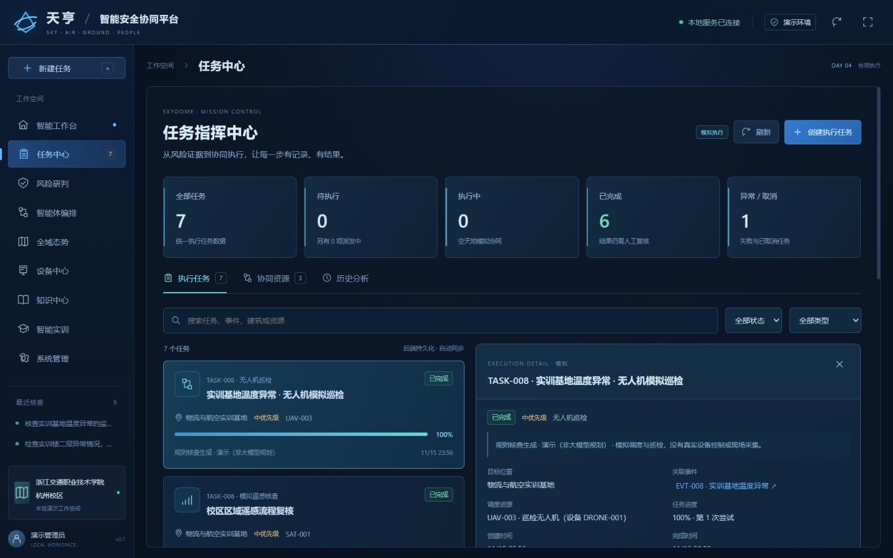
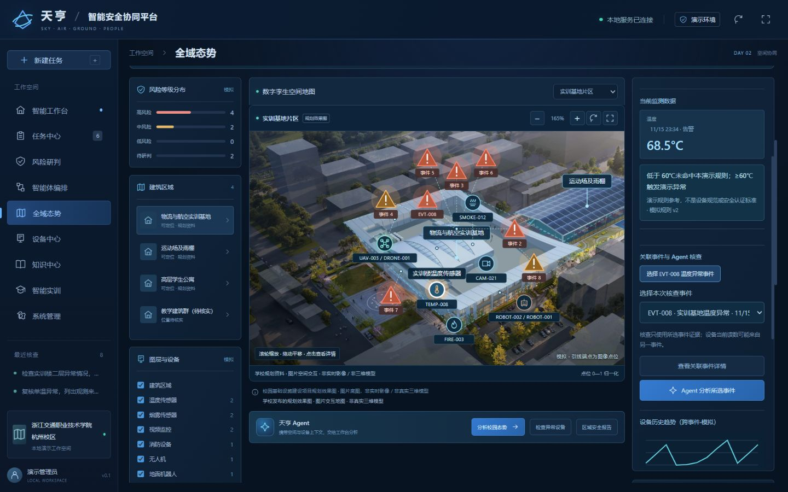
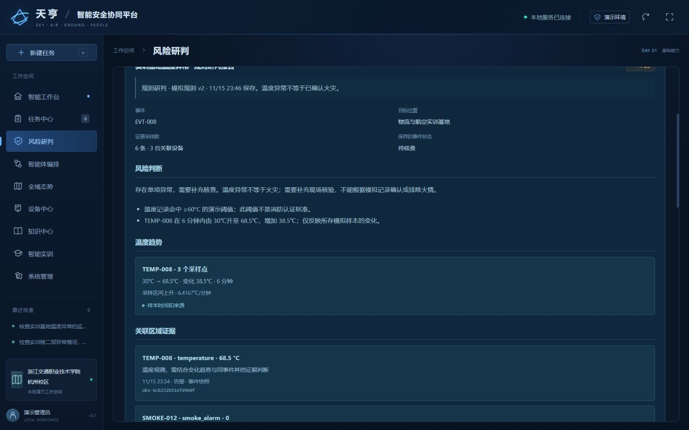
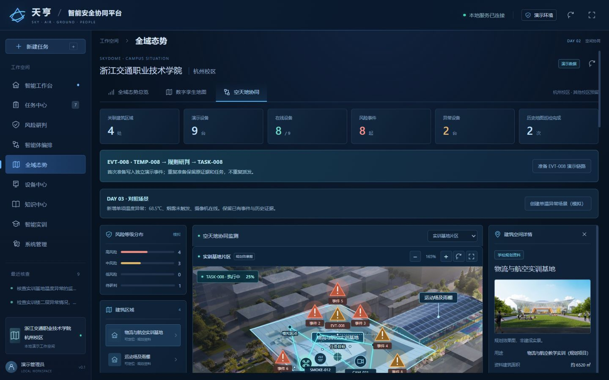
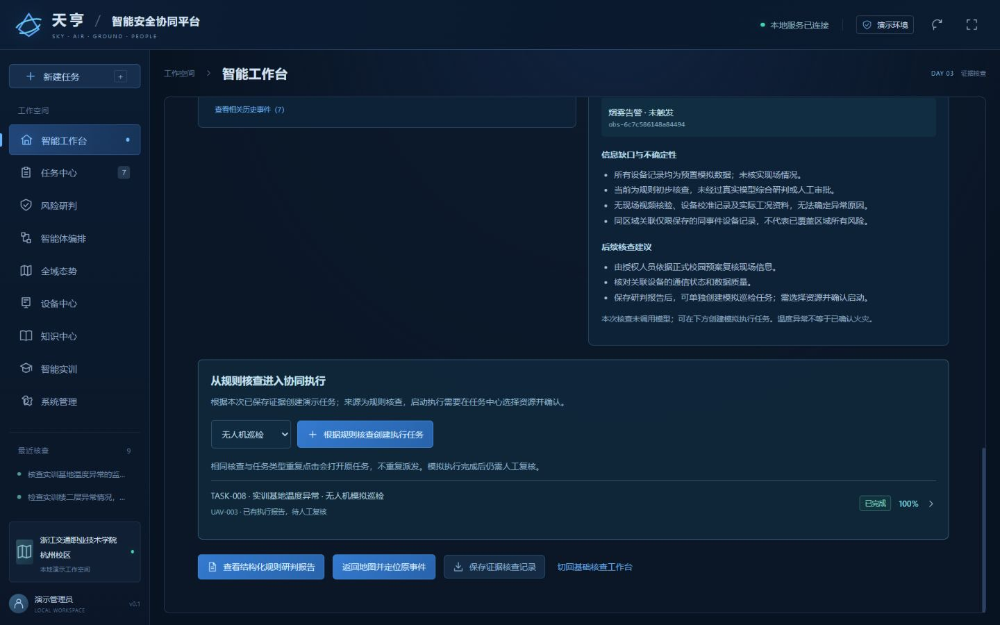

# 天亨 SKYDOME Agent 使用手册

**本地演示版 · 适用应用版本 0.5 · 手册版本 1.0**

编制日期：2026 年 11 月 16 日。面向演示人员、产品体验人员和项目维护人员。

这份手册介绍当前已经实现的操作。建议先完成“快速上手”，再按需要查看各模块。截图来自本项目实际验收过程，截图中的时间、任务总数和进度只代表拍摄时状态，以当前页面为准。

> **先了解三个边界**：校园底图是用户提供的学校规划资料，不是实时航拍或可旋转的三维模型；监测数据与空天地执行属于模拟；Agent 页面采用规则分析，尚未接入大模型自主研判。工具查询、任务状态变化和报告保存是真实运行的程序功能。

## 01 · 启动、打开与停止

### 从桌面启动

1. 双击桌面的 **“天亨 SKYDOME”** 图标。
2. 等待前端与后端就绪，默认浏览器会打开系统。
3. 确认页面顶部显示 **“本地服务已连接”**，能正常进入工作台或上次打开的页面。

服务已运行时，入口会直接打开页面，不重复启动服务。连续双击无需反复操作，正在进行的启动会先完成。

系统地址：[http://127.0.0.1:5173](http://127.0.0.1:5173)。这是当前电脑的本地地址，不能把该地址发给其他人作为公网访问链接。

### 关闭与彻底停止

关闭浏览器只关闭页面，后台服务仍可能运行。需要彻底停止时，在项目文件夹打开 PowerShell，执行：

```powershell
.\scripts\stop.ps1
```

停止服务不会删除任务、报告或历史证据。模拟进度按已保存的时间计算；停止服务不等于取消任务。如果要终止某项任务，应在任务详情中先点击 **“取消本次任务”**。

### 无桌面图标时

在项目根目录执行下列命令，启动成功后打开上面的系统地址：

```powershell
.\scripts\start.ps1
```

桌面入口依赖原项目文件夹和已配置的运行环境。如果移动项目，需要重新生成快捷方式；不要只复制快捷方式就认为迁移了整个系统。

## 02 · 认识界面与入口

左侧为页面导航；顶部用于查看连接状态、刷新数据和全屏；页面中央展示当前业务内容。部分详情在右侧抽屉中打开，可滚动查看并使用关闭按钮收起。

| 页面 | 主要用途 | 建议操作 |
|---|---|---|
| 智能工作台 | 发起核查、查看证据和工具过程、生成关联任务 | 从地图事件或设备进入证据核查 |
| 任务中心 | 管理模拟执行任务、资源、日志和报告 | 查看“执行任务”“协同资源”“历史分析” |
| 风险研判 | 阅读已经保存的规则研判报告 | 选择相应核查记录，核对事件与证据 |
| 智能体编排 | 查看当前固定工具流程 | 阅读流程说明；不是可拖拽编辑器 |
| 全域态势 | 校园总览、图片地图、空天地协同 | 点击建筑、设备和风险事件 |
| 设备中心 | 检索设备、查看当前读数和关联事件 | 搜索 TEMP-008 并打开详情 |
| 知识中心 | 检索预置演示资料 | 搜索关键词，点击文档查看原文 |
| 智能实训 | 建立新的独立演示场景 | 需要新增训练事件时使用 |
| 系统管理 | 查看连接、数据库和模型能力状态 | 故障排查时查看 |

**三个“新建”用途不同：**左侧 **“新建任务 ＋”** 新建基础核查会话；任务中心 **“创建执行任务”** 新建巡检或区域核查任务；智能实训 **“创建新的演示场景”** 新建一组模拟事件和数据。创建场景不等于已经执行核查或巡检。

页面通过左侧导航切换，浏览器地址通常仍然是 `/`。直接输入 `/tasks` 或 `/risk` 不是当前版本的使用方式。

部分页面右上角保留 DAY 01—04 模块标签，它们表示原开发模块，不是系统总版本；整体版本查看“系统管理”。

## 03 · 快速上手：先看结果，再重新演示

### 当前安装已有 TASK-008 时

交付验收曾完成 TASK-008。如果它已显示“已完成”，这是已保存的正常结果，并非启动失败。

1. 进入 **任务中心 → 执行任务**，在搜索框输入 `TASK-008`。
2. 点击任务卡片，查看关联事件 **EVT-008**、资源 **UAV-003**、进度和执行日志。
3. 点击 **“查看执行报告”**，阅读模拟巡检发现、后续建议和适用范围。
4. 展开 **“关联来源与设备”**，点击 **“返回来源规则核查 … ↗”**，查看原始证据和已完成任务反馈。
5. 若要再次观看飞行动画，回到任务详情点击 **“新建重试任务”**。
6. 在新任务中选择 UAV-003，点击 **“保存资源选择”**，再点 **“确认启动模拟任务”**，随后点 **“查看地图与路线”**。

重试使用新的任务编号，保留旧任务和报告。同一父任务重复点击重试会打开已经创建的直接子任务；需要继续下一轮时，应在最新已结束的任务上再点“新建重试任务”。不要把新编号强行改称 TASK-008。



### 还没有 EVT-008 或希望从异常发现开始

从下一节的步骤 A 开始。**“准备 EVT-008 演示链路”**首次建立固定场景；已有时会复用，不会重置旧任务、报告或证据。

## 04 · 完整操作：从异常发现到执行反馈

### A. 进入校园与目标建筑

在智能工作台或全域态势点击 **“准备 EVT-008 演示链路”**。系统会打开地图并选中 **物流与航空实训基地**。也可以通过左侧 **“全域态势”**进入，再切换 **“数字孪生地图”**。

点击建筑区域或建筑列表，右侧展示名称、用途、可核实的资料面积、关联设备和事件。实训基地资料面积约 6520㎡，是规划资料中的建筑面积；楼层示意不能作为实际楼层图使用。

### B. 检查 TEMP-008 与 EVT-008

点击地图中的 **TEMP-008**，或在建筑详情的关联设备列表中选择它。核对设备编号、所属建筑、采样时间、数据质量、告警状态和当前监测值。

固定演示场景的温度样本为 **30℃ → 49℃ → 68.5℃**，烟雾传感器未触发，摄像机通信在线。当前设备读数来自最新保存数据；后续若创建新场景，读数可能变化。

在 **“关联事件与 Agent 核查”**中点击 **“选择 EVT-008 温度异常事件”**，或从事件选择框明确选择 EVT-008。先查看事件是否正确，再点 **“Agent 分析所选事件”**。未选事件时分析按钮不可用。

> **参考范围的含义**：当前“≥60℃触发演示异常”是模拟规则，不是消防认证阈值。低于 60℃仅表示未命中这条规则，不能据此认定实际环境安全。摄像机“在线”也不表示系统已经看过现场视频。



### C. 发起证据核查

工作台打开 **“事件证据核查”**后，确认事件为 EVT-008、目标建筑为物流与航空实训基地。页面同时展示保存的关联设备、监测记录和历史事件。

在 **“核查目标”**输入框保留默认文本，或输入例如：“核查温度变化、烟雾状态和同区域设备，列出证据与信息缺口。” 点击 **“执行三项查询（规则演示）”**。已有运行时，按钮会显示 **“重新执行三项查询（规则演示）”**。

| 工具步骤 | 可以观察到的内容 |
|---|---|
| 监测数据查询 | 与本次证据快照关联的读数、采样时间和证据 ID |
| 关联设备查询 | 关联设备及通信、告警状态 |
| 历史事件检索 | 已保存的相关历史事件 |
| 规则初评 | 风险判断、依据、建议与不确定性 |

展开 **“真实工具执行记录”**中的条目，可查看工具名称、状态、耗时和返回记录。查询可能很快完成，不保证每次都能肉眼看到所有中间状态；已保存的日志可以展开回看。需要中止尚在运行的核查时，使用 **“停止本次核查”**。

输入更长指令不会让当前固定流程自动增加工具，也不代表系统已进行自由对话或大模型自主推理。

### D. 阅读和保存规则研判报告

核查完成后点击 **“查看结构化规则研判报告”**，或进入左侧 **“风险研判”**并在 **“查看已保存核查”**中选择对应记录。

报告包含事件、建筑、证据采样数、风险判断、温度趋势、同事件关联证据、可能原因、处置建议、信息缺口和规则版本。请同时阅读风险结论和不确定性。

当前固定场景的三个温度样本在 6 分钟内上升 38.5℃。这一计算描述已存模拟样本，不是对真实校园火灾的确认。界面显示“中风险”等级时，也不能把它当作经过现场核实的结论。

点击 **“保存规则研判报告 JSON”**下载副本。报告在核查成功结束时已由后端保存，下载按钮的作用是把副本保存到浏览器下载位置。



### E. 根据核查结果创建执行任务

点击 **“返回核查并规划执行任务”**或 **“返回核查工作台”**。在工作台 **“从规则核查进入协同执行”**区域选择 **“无人机巡检”**，点击 **“根据规则核查创建执行任务”**。

系统保留来源事件、证据、设备和建筑，打开任务中心中的任务详情。固定链路首次有效创建的根无人机任务使用 TASK-008；已有根任务、后续核查或重试的编号遵循实际保存记录，不保证每次都叫 TASK-008。

同一核查、同一任务类型再次点击创建，会打开原任务，避免重复派发。任务创建后通常为待执行，尚未开始占用或控制资源。

### F. 选择资源并启动模拟巡检

在任务详情的 **“选择协同资源”**中选中 **UAV-003**。其他资源不可选时会显示原因，如离线、被占用或类型不匹配。

1. 点击 **“保存资源选择”**。
2. 确认资源信息后点击 **“确认启动模拟任务”**。
3. 观察状态由 **待执行 → 派发中 → 执行中 → 已完成**变化。
4. 启动后立即点击 **“查看地图与路线”**，观察任务目标、模拟起点、航线、当前位置和进度。

当前任务中心流程采用约 **3 秒调度 + 24 秒执行**的模拟时长，不代表实际飞行耗时。页面按保存时间更新进度；中途刷新不会把同一任务重新置零。



### G. 查看结果并返回工作台

任务完成后，在任务详情点击 **“查看执行报告”**，查看本次执行资源、时间、范围、模拟发现和建议。点击 **“下载此任务报告 JSON”**保存副本。

展开 **“关联来源与设备”**，通过 **“返回来源规则核查 … ↗”**返回工作台。在 **“从规则核查进入协同执行”**区域可看到同一任务 **已完成 / 100% / 已有执行报告，待人工复核**。也可在风险研判页面的 **“关联执行任务与反馈”**打开该任务。

**完成巡检不等于解除风险。**当前版本会保留原事件，尚没有人工复核录入、正式审批或关闭风险的完整业务流程。



## 05 · 任务中心的日常操作

### 手动创建执行任务

进入 **任务中心 → 执行任务 → 创建执行任务**。填写任务名称，选择关联风险事件、任务类型和优先级，再点击 **“保存待执行任务”**。

任务类型包括无人机巡检、地面巡检、模拟遥感核查。目标建筑和关联设备从所选事件绑定，不是任意输入地址。手动创建的任务会标明手动来源；不会凭空生成一份 Agent 研判报告。

创建后仍须在详情中选择适配资源、保存选择并确认启动。

手动创建的执行任务没有来源核查记录，因此不会出现“返回来源规则核查”按钮；可通过关联事件回到地图继续查看。

### 搜索、筛选与历史记录

在 **“执行任务”**中按任务编号、名称、建筑或资源搜索，并组合状态和类型筛选。找不到任务时，先清空搜索，恢复 **“全部状态”**和 **“全部类型”**，再刷新。

**“协同资源”**查看资源的在线状态、当前位置或覆盖范围、电量、能力和当前任务；**“历史分析”**查看已有的规则核查和地图关联分析。核查记录与执行任务是不同对象，历史核查不会直接计入执行任务总数。

### 取消、失败与重试

待执行、派发中或执行中的任务可点 **“取消本次任务”**。取消会保留任务记录并停止该次模拟进度，不会生成“已成功完成”的执行报告。

已完成、失败或已取消的任务可点 **“新建重试任务”**，创建关联的新任务。需要重新核对资源并确认启动；原任务与原报告不会被覆盖。

| 状态 | 含义 | 下一步 |
|---|---|---|
| 待执行 | 任务已保存，尚未启动 | 选择资源并保存，再确认启动 |
| 派发中 | 模拟调度已开始 | 查看日志；必要时取消 |
| 执行中 | 模拟执行推进中 | 查看地图、进度与日志 |
| 已完成 | 执行记录和报告已保存 | 查看报告，人工复核，或创建重试 |
| 已取消 | 本次执行主动停止 | 保留记录；需要时创建重试 |
| 执行失败 | 资源状态或执行条件不满足 | 先阅读错误原因，条件恢复后重试 |

## 06 · 地图与空天地协同

### 三个视图

**全域态势总览**用于浏览指标、建筑、设备和事件；**数字孪生地图**用于空间定位和对象详情；**空天地协同**用于观察资源、巡检和执行状态。三个视图共用数据，不需要分别录入任务。

使用片区选择框切换实训基地片区与学生公寓等已提供资料的片区。不同来源的鸟瞰图分别展示，不能把它们理解为经过测绘拼接的完整校园坐标系统。

### 地图操作

| 操作 | 方法 |
|---|---|
| 放大 / 缩小 | 点击地图上的“＋ / −”，或在地图内滚动鼠标滚轮 |
| 移动视野 | 在地图空白处按住鼠标拖动 |
| 恢复视野 | 点击地图复位图标（“恢复全部视野”） |
| 全屏 | 点击地图全屏图标；再次点击退出；浏览器支持时可按 Esc |
| 查看建筑 | 点击建筑热点或建筑列表 |
| 查看设备 / 事件 | 点击标记，或从列表与关联对象入口定位 |
| 键盘操作 | 地图获得焦点后，加减号缩放，方向键平移，Home 复位 |

图层可独立控制：建筑区域、温度传感器、烟雾传感器、视频监控、消防设备、无人机、地面机器人、风险事件和巡检航线。关闭图层只隐藏地图对象，不删除数据，也不会停止正在执行的任务。

建筑详情中的楼层示意属于模拟空间，不应当成真实室内导航依据。缺少空间位置依据的对象可能不支持完整路线，不要根据地图热点反推精确地理位置。

点击 **“进入建筑空间 · 模拟”**可查看楼层示意，再点 **“收起楼层示意”**返回。当前实训基地、运动场及雨棚、高层学生公寓有片区定位；**“教学建筑群（待核实）”没有确认坐标或可点击热点**。公寓楼层资料存在冲突，仍须核实。地图标记可能为避免重叠而偏移，带引线时以引线端点对应图片位置。

### 地图上的其他 Agent 入口

“分析校园态势”“检查异常设备”“区域安全报告”“分析当前建筑风险”“交给 Agent 分析巡检计划”等入口，建立的是带空间上下文的地图关联分析，可在对应工作台查看规则摘要、下载记录并返回地图。它们不等同于本手册第 04 节的三工具证据核查流程；要演示完整事件处置链路，请从设备关联事件或事件详情的 **“发起研判 · 证据核查”**进入。

### 两类巡检入口的区别

| 入口 | 用途与记录 | 时长与资源 |
|---|---|---|
| 任务中心的空天地执行 | 推荐主流程；关联风险、来源核查、TASK 编号和执行报告 | 3 秒调度 + 24 秒执行；UAV-003 等调度资源 |
| 地图原有“无人机模拟巡检” | 独立的航线演示；选择目标后“生成巡检航线”→“确认巡检任务” | 约 12 秒；使用 DRONE-001 设备记录 |

两类流程保留各自历史，并共用资源占用约束。旧地图巡检正在运行时，任务中心可能不能同时使用对应无人机。地图存在 **“收起执行路线，查看原巡检”**入口，用于切换展示对象，不能把两份进度混为一项任务。

UAV-003 对应地图设备 DRONE-001；ROBOT-002 对应 ROBOT-001，是调度编号和设备编号的对应关系。SAT-001 为模拟遥感资源，没有真实卫星影像，不能期望它出现无人机式飞行路线。

## 07 · 设备、事件与证据怎么读

设备中心可按设备编号、名称或类型搜索，点击卡片打开详情。通过 **“地图定位设备”**返回空间位置；通过关联事件选择进入核查。

| 信息 | 应如何理解 |
|---|---|
| 当前设备数据 | 最新保存的模拟观测；可能来自后续建立的场景 |
| 设备历史趋势（跨事件·模拟） | 设备在多个事件中的历史样本，不等于单一事件持续监测 |
| 事件关联证据 | 本次选中事件的证据范围 |
| 保存时的当前状态 | 创建证据快照时保存的设备状态 |
| 已保存研判报告 | 基于当时冻结证据生成，不会随新读数改写 |

因此，当前设备读数与旧报告不同并不必然是错误。先比对事件、采样时间和证据范围，再判断是否选错记录。再次执行同一快照仍使用该快照；需要新的当前证据时，应从地图或设备重新进入对应事件核查。

没有监测值、没有事件或没有趋势时，界面显示空态或待核实，不应解读成设备安全或区域无风险。

## 08 · 报告、保存和数据保留

| 保存内容 | 操作入口 | 作用 |
|---|---|---|
| 规则研判报告 | 风险研判 → “保存规则研判报告 JSON” | 保存结构化判断、证据与限制 |
| 模拟执行报告 | 任务详情 → “查看执行报告”→“下载此任务报告 JSON” | 保存该次任务资源、时间、结果与建议 |
| 证据核查记录 | 证据工作台 → “保存证据核查记录” | 导出本次核查与工具记录 |
| 历史基础核查 | 旧记录详情 → “保存历史核查记录 JSON”等现有入口 | 保存旧结果；不冒充新结构化报告 |

JSON 是结构化数据文件，可供技术人员查看或后续处理。当前产品没有正式 PDF 报告导出；本使用手册的网页版可以通过浏览器 **Ctrl+P** 打印或另存为 PDF，两者是不同功能。

任务、核查、快照和报告保存在本机数据目录 `%LOCALAPPDATA%\TianqiongDemo`。名称属于兼容旧版本的技术路径，不代表产品名称未修改。浏览器通常把下载文件保存到“下载”文件夹，具体以浏览器设置为准。

刷新页面和重新启动服务会读取已保存业务记录；页面选择由浏览器保存。清除浏览器数据可能丢失当前选择，但不等于删除后端记录，可从任务中心或历史分析重新打开。复制桌面快捷方式不会复制数据库。

## 09 · 其他页面怎么使用

**知识中心：**输入“烟雾”“设备”“报告”等关键词检索资料，点击文档查看原文，关闭文档返回列表。没有匹配结果时可点“清空搜索”。当前是预置演示资料，不是自动联网检索或已接入 RAG 的问答知识库。

**智能体编排：**查看当前固定的接收指令、查询监测、查询设备、查询历史和规则初评流程。页面说明未来能力，但没有开放拖拽编排或任意增加工具。

**智能实训：**点击“创建新的演示场景”会新增独立场景并保留旧记录。它不是清空系统，也不是固定 EVT-008 的重置入口；新场景可能影响设备的最新读数。

**系统管理：**查看应用版本、数据库连接、工作流模式和模型状态。“独立模型探测已验证”仅代表独立探针测试曾成功，不代表当前工作台正在调用大模型。

## 10 · 常见问题与处理

| 现象 | 建议处理 |
|---|---|
| 双击桌面图标没有立即出现页面 | 等待启动完成；不要连续点击。失败弹窗会指出原因和日志位置 |
| 提示 8000 或 5173 端口被占用 | 若原系统可用，直接打开本地地址。若只启动了一部分，在项目目录运行 stop.ps1 后再启动；它不会代替你停止不属于本项目的软件 |
| 页面显示连接需检查 | 确认本机服务已启动，点顶部“刷新数据”；仍失败时保留错误文字并查看日志 |
| 搜索不到任务 | 清空搜索、恢复全部状态和类型，并确认正在“执行任务”页签；核查记录在“历史分析”中 |
| 找不到 TASK-008 | 先准备固定场景，完成对应事件的证据核查并生成无人机任务；后续记录可能使用新编号，不要删历史来抢编号 |
| 已完成任务没有启动按钮 | 这是终态；使用“新建重试任务”，再对新任务分配资源 |
| 资源不能选择或启动按钮灰色 | 阅读不可用原因；确认任务待执行、资源适配且在线，先保存选择，再确认启动 |
| UAV-003 一直被占用 | 查看协同资源的当前任务，检查任务中心任务或旧地图巡检是否仍在运行；不要重复创建任务抢占 |
| 事件分析按钮灰色 | 先在设备关联事件中选择有效事件。无关联事件时不能对任意其他事件发起核查 |
| 风险页提示尚未选择核查 | 从地图事件或设备进入证据工作台，或在风险页选择已有核查记录 |
| 旧核查没有结构化报告 | 保留旧记录；按提示返回同一证据重新执行，或从事件建立新的证据核查 |
| 地图看不到航线或无人机 | 检查当前片区、所选任务及“巡检航线”“无人机”图层；优先从任务详情点“查看地图与路线” |
| 执行已完成，但事件仍是待核查 | 正常；模拟完成不表示人工确认风险解除 |
| 关闭浏览器后任务仍变成已完成 | 模拟进度按保存时间推进，关闭网页不是取消。需要终止时使用“取消本次任务” |
| 当前读数与旧报告不同 | 核对事件和时间；旧报告使用冻结证据，设备当前读数可能已更新 |
| 手册截图与当前数字不同 | 截图是验收示例；任务数和读数以当前保存数据为准 |

启动日志：`%LOCALAPPDATA%\TianqiongDemo\desktop-launcher.log`；服务日志在同目录的 `backend.stderr.log`、`frontend.stderr.log` 等文件中。反馈问题时，记录操作步骤、事件/任务编号、错误文字和发生时间即可，不要在反馈中粘贴 API Key。

## 11 · 演示前检查与讲解顺序

1. 打开系统，确认“本地服务已连接”。
2. 确认固定事件 EVT-008 可选，UAV-003 没有被其他巡检占用。
3. 先讲建筑和设备，再讲异常证据；明确 68.5℃是模拟值。
4. 展示三项工具记录、规则报告和信息缺口，说明温度异常不等于确认火灾。
5. 从核查创建任务，或对已有完成任务创建重试；说清本次实际任务编号。
6. 保存资源选择并确认启动后，立即进入地图，避免错过约 27 秒的模拟过程。
7. 展示执行日志、结果报告和工作台反馈；以“等待人工复核”结束演示。

推荐讲解语：“系统把选定事件的证据、规则分析和后续模拟任务关联起来，可以追溯每一步使用的数据和保存的结果。当前展示的是规则核查与模拟执行闭环，尚未连接真实设备或大模型自主规划。”

## 12 · 当前能力范围与维护位置

| 类别 | 当前能力 |
|---|---|
| 已可实际操作 | 页面导航、设备/事件查询、证据快照、工具记录、规则计算、任务状态、资源分配、地图动画、报告保存与回看 |
| 模拟内容 | 设备部署、监测读数、事件、规则阈值、无人机/机器人/遥感任务及执行发现 |
| 素材依据 | 用户提供的校园规划资料；建筑位置、楼层和面积按已核实范围展示，缺失信息保留待核实 |
| 尚未接入 | 大模型自主研判和工具规划、真实视频/设备/飞行/卫星数据、正式审批与风险关闭、正式 PDF、多用户权限、公网服务 |

本项目路径：`<项目目录>`。

维护人员可参考 [README 启动说明](../README.md)、[最终交付与验收说明](day5-final-delivery.md)及[参考素材分析表](参考素材分析表.md)。业务页面与技术文档用途不同；正常使用不需要修改代码、数据库或模型密钥。

手册依据为当前源码按钮与行为、DAY 04 / DAY 05 实测记录以及桌面启动器验证。未为编写手册新增、重置或执行任何业务任务。
